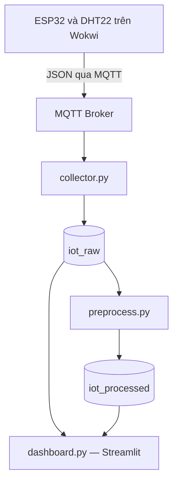

# Bài thực hành số 2 — Thu thập, lưu trữ và tiền xử lý dữ liệu IoT

**Học phần:** IoT và Ứng dụng (INT14149)  
**Sinh viên:** Nguyễn Tiến Đạt  
**Mã sinh viên:** B23DCCN140  
**Trường:** Học viện Công nghệ Bưu chính Viễn thông

## 1. Giới thiệu

Hệ thống thu thập nhiệt độ và độ ẩm từ ESP32 mô phỏng trên Wokwi, truyền bản tin JSON qua MQTT, lưu dữ liệu vào InfluxDB và hiển thị trên dashboard Streamlit. Chương trình tiền xử lý chạy theo từng đợt để làm sạch dữ liệu, resampling và tạo đặc trưng.

## 2. Kiến trúc



## 3. Công nghệ và cấu trúc mã nguồn

- ESP32, DHT22 và Wokwi.
- MQTT broker: `broker.hivemq.com`, cổng `1883`.
- Python, paho-mqtt, influxdb-client, pandas, numpy, python-dotenv.
- InfluxDB OSS 2.x chạy bằng Docker.
- Streamlit và Plotly; môi trường thực hành: GitHub Codespaces.

Cấu trúc repository cần có khi nộp:

```text
iot-lab2/
├── firmware/
│   ├── sketch.ino
│   ├── diagram.json
│   └── libraries.txt
├── collector.py
├── preprocess.py
├── dashboard.py
├── requirements.txt
├── .env.example
├── .gitignore
└── README.md
```

Các file trong `firmware/` được sao chép từ dự án Wokwi. Bổ sung link Wokwi của bài 2 vào repository trước khi nộp.

## 4. Cài đặt

Thực hiện các lệnh trong thư mục gốc của dự án, trên terminal Bash của Codespaces. Cần có Python 3, Docker và kết nối mạng tới MQTT broker.

### 4.1. Môi trường Python

```bash
python -m venv .venv
source .venv/bin/activate
python -m pip install -r requirements.txt
```

Nội dung `requirements.txt`:

```text
paho-mqtt
influxdb-client
python-dotenv
pandas
numpy
streamlit>=1.37
plotly
```

Collector sử dụng API callback phiên bản 2 của paho-mqtt; cài paho-mqtt 2.x nếu môi trường đang dùng bản cũ.

### 4.2. Khởi động InfluxDB

Kiểm tra container trước:

```bash
docker ps -a
```

Nếu chưa có container `influxdb2`, tạo một lần:

```bash
docker run -d \
  --name influxdb2 \
  -p 8086:8086 \
  -v influxdb2-data:/var/lib/influxdb2 \
  -v influxdb2-config:/etc/influxdb2 \
  influxdb:2
```

Nếu container đã tồn tại nhưng đang dừng:

```bash
docker start influxdb2
```

Kiểm tra dịch vụ:

```bash
curl http://localhost:8086/health
```

Kết quả sẵn sàng có `"status": "pass"`.

Trong tab **PORTS** của Codespaces, chuyển tiếp cổng `8086`, giữ **Private** và mở bằng **Open in Browser**. Khởi tạo tài khoản nếu đây là lần đầu, sau đó cấu hình:

| Thành phần | Giá trị |
|---|---|
| Organization | `ptit` |
| Bucket dữ liệu gốc | `iot_raw`, retention 7 ngày |
| Bucket dữ liệu xử lý | `iot_processed`, retention 30 ngày |

Vào **Load Data → API Tokens**, tạo Custom API Token có quyền **Read và Write** cho cả hai bucket. Sao chép token vào `.env`.

### 4.3. Cấu hình biến môi trường

Tạo `.env.example` với nội dung:

```dotenv
MQTT_HOST=broker.hivemq.com
MQTT_PORT=1883
MQTT_TOPIC=ptit/iot2/B23DCCN140/dat-a73f/telemetry

INFLUX_URL=http://localhost:8086
INFLUX_ORG=ptit
INFLUX_TOKEN=
INFLUX_BUCKET_RAW=iot_raw
INFLUX_BUCKET_PROCESSED=iot_processed
```

Nếu chưa có `.env`, sao chép file mẫu:

```bash
cp .env.example .env
```

Điền token thật vào `.env`. Topic và broker phải giống chính xác cấu hình trong firmware Wokwi. Python chạy bên trong Codespaces nên dùng `http://localhost:8086`, không dùng URL chuyển tiếp cổng `app.github.dev`.

Không ghi đè `.env` đã cấu hình khi cài đặt lại. Sau khi thay token, khởi động lại collector và dashboard.

Nội dung `.gitignore`:

```gitignore
.env
.venv/
__pycache__/
*.pyc
```

Không commit token, mật khẩu hoặc file `.env` thật lên GitHub.

## 5. Chạy hệ thống

### Bước 1 — Thu thập dữ liệu

Trong terminal thứ nhất:

```bash
source .venv/bin/activate
python collector.py
```

Sau đó bật mô phỏng Wokwi. ESP32 cần kết nối Wi-Fi, đồng bộ thời gian và gửi bản tin tới đúng broker/topic. Khi thành công, collector hiện:

```text
InfluxDB reachable
MQTT connect: Success
Subscribed: ptit/iot2/B23DCCN140/dat-a73f/telemetry
SAVED #... | seq=... | T=... | H=... | receive_latency=... ms | db_write=... ms
```

Giữ terminal này chạy. `SAVED` chỉ xuất hiện sau khi ghi InfluxDB thành công.

### Bước 2 — Tiền xử lý

Thu dữ liệu vài phút và thay đổi cảm biến để có dữ liệu đa dạng. Trong terminal thứ hai:

```bash
source .venv/bin/activate
python preprocess.py
```

Chương trình mặc định lấy 30 phút gần nhất, chỉ xử lý các cửa sổ 10 giây đã kết thúc. Kết quả thành công có:

```text
DONE: da ghi ... diem vao iot_processed
RUN_ID: ...
```

Mỗi lần chạy tạo một `run_id` riêng. Đây là xử lý theo đợt; chạy lại lệnh khi cần cập nhật dữ liệu đã xử lý.

### Bước 3 — Dashboard

Trong terminal thứ ba:

```bash
source .venv/bin/activate
python -m streamlit run dashboard.py --server.address 0.0.0.0 --server.port 8501
```

Chuyển tiếp cổng `8501` trong tab **PORTS**, giữ **Private** rồi chọn **Open in Browser**.

Trên dashboard:

1. Chọn khoảng thời gian và thiết bị.
2. Chọn **Tự chọn đợt mới nhất** hoặc một `run_id` cụ thể.
3. Bật tự động làm mới mỗi 5 giây.
4. Thay đổi cảm biến trên Wokwi để theo dõi dữ liệu gốc.
5. Chạy lại `preprocess.py` để cập nhật dữ liệu sau xử lý.

Tự làm mới dashboard chỉ đọc lại database, không tự chạy tiền xử lý. Cổng `8086` là giao diện InfluxDB; cổng `8501` là dashboard. Link Codespaces Private yêu cầu quyền truy cập phù hợp và dịch vụ phải đang chạy.

## 6. Bản tin và schema

Các trường JSON bắt buộc:

| Trường | Kiểu và ý nghĩa |
|---|---|
| `device_id` | Chuỗi định danh thiết bị |
| `boot_id` | Chuỗi định danh lần khởi động |
| `sequence` | Số nguyên không âm, thứ tự bản tin |
| `timestamp_ms` | Số nguyên Unix epoch milliseconds tại thời điểm đo |
| `temperature` | Số hữu hạn, từ −40 đến 80°C |
| `humidity` | Số hữu hạn, từ 0 đến 100%RH |

Firmware phải gửi timestamp thực sau đồng bộ thời gian, không dùng giá trị uptime thay cho Unix timestamp.

| Thành phần | Dữ liệu gốc | Dữ liệu xử lý |
|---|---|---|
| Bucket | `iot_raw` | `iot_processed` |
| Measurement | `sensor_raw` | `sensor_processed` |
| Tags | `device_id` | `device_id`, `run_id` |
| Timestamp | Thời điểm đo từ thiết bị | Đầu cửa sổ 10 giây |
| Fields | `boot_id`, `sequence`, `temperature`, `humidity`, `received_at_ms`, `latency_ms` | Giá trị xử lý, đặc trưng và cờ chất lượng |

Đặc trưng cho mỗi đại lượng gồm hậu tố `_rolling_mean`, `_delta`, `_normalized`. Các trường chất lượng gồm `sample_count`, `outlier_count`, `is_imputed`, `is_valid`.

## 7. Phương pháp tiền xử lý

1. Đọc dữ liệu theo khoảng thời gian và xử lý riêng từng thiết bị.
2. Loại trùng theo `device_id`, `boot_id`, `sequence`.
3. Phát hiện ngoại lệ bằng IQR; bỏ qua bước phát hiện khi có ít hơn 8 giá trị hợp lệ hoặc IQR bằng 0.
4. Thay giá trị ngoại lệ bằng giá trị thiếu và tính trung bình theo cửa sổ 10 giây.
5. Nội suy khoảng thiếu ngắn, tối đa 2 ô liên tiếp, có dữ liệu ở cả hai phía. Giữ nguyên khoảng thiếu dài và khoảng thiếu ở đầu/cuối chuỗi.
6. Tính rolling mean với 6 ô đầy đủ, delta giữa hai ô và chuẩn hóa Min-Max.
7. Lưu kết quả sang `sensor_processed` với `run_id` của đợt chạy.

Rolling mean trống trong 5 ô đầu là bình thường. Min-Max được tính riêng từng thiết bị và từng đợt nên giá trị chuẩn hóa giữa các đợt có thể khác nhau.

## 8. Kiểm thử và đánh giá

| Tình huống | Thao tác | Nội dung kiểm tra |
|---|---|---|
| Bình thường | Chạy 5–10 phút, thay đổi nhẹ cảm biến | `SAVED`, biểu đồ cập nhật, thống kê độ trễ |
| Ngoại lệ | Đặt 65°C khoảng 10 giây rồi đưa về mức bình thường | `outlier_count`, đường trước và sau xử lý |
| Thiếu ngắn | Dừng Wokwi khoảng 10 giây, chạy lại và chờ thêm dữ liệu | Có thể có `is_imputed = true`, tùy ranh giới cửa sổ và thời gian kết nối lại |
| Thiếu dài | Dừng Wokwi khoảng 60 giây, chạy lại và chờ thêm 30 giây | Khoảng thiếu dài giữ `is_valid = false` |

Chạy lại tiền xử lý sau mỗi tình huống và chọn đúng `run_id`. IQR phụ thuộc phân bố mẫu; không mặc định mọi lần tăng lên 65°C đều bị đánh dấu. Việc dừng mô phỏng tạo gián đoạn nguồn dữ liệu, không phải phép đo riêng tỷ lệ mất gói mạng.

### Ý nghĩa các phép đo

- `latency_ms = received_at_ms − timestamp_ms`: độ trễ từ thời điểm đo đến collector nhận.
- `db_write`: thời gian chờ yêu cầu ghi InfluxDB hoàn tất; hiện chỉ in ở terminal.
- Tuổi mẫu mới nhất: thời gian dashboard tính toán trừ thời điểm đo của mẫu mới nhất.
- P95: phân vị 95% của độ trễ nhận trong khoảng hiển thị.

Code hiện tại chưa đo đầy đủ độ trễ end-to-end đến lúc trình duyệt hiển thị. Không coi `latency_ms` là độ trễ toàn hệ thống. Thời gian cập nhật dashboard còn chịu ảnh hưởng của chu kỳ làm mới 5 giây. Độ trễ âm là dấu hiệu cần kiểm tra đồng bộ đồng hồ.

Ghi số đo và ảnh thực tế vào báo cáo; README không đưa ra kết quả đo giả định.

## 9. Xử lý lỗi thường gặp

| Hiện tượng | Kiểm tra/cách xử lý |
|---|---|
| Chỉ hiện `Subscribed`, không có `SAVED` | Bật Wokwi; đối chiếu broker, port, topic; xem Serial Monitor |
| `403 insufficient permissions for write` | Token cần quyền Write vào bucket đích; thay token và chạy lại chương trình |
| `401 Unauthorized` | Kiểm tra token trong `.env` |
| `Connection refused` cổng 8086 | Kiểm tra Docker và khởi động container |
| Không có dữ liệu 30 phút gần nhất | Kiểm tra collector có `SAVED`; chờ cửa sổ 10 giây kết thúc; dữ liệu cũ cần mở rộng khoảng đọc trong code |
| `INVALID: Timestamp...` | Kiểm tra đồng bộ thời gian ESP32 và đơn vị milliseconds |
| Dashboard không có dữ liệu xử lý | Chạy `preprocess.py`, kiểm tra `DONE`, thiết bị, khoảng thời gian và `run_id` |
| Thiếu `st.fragment` | Cập nhật Streamlit trong đúng môi trường `.venv`, khởi động lại dashboard |
| Container trùng tên | Dùng container `influxdb2` hiện có, không tạo lại |

## 10. Giới hạn và hướng cải tiến

- Collector lưu tối đa 10.000 khóa chống trùng trong bộ nhớ; mất bộ nhớ này khi restart.
- Khoảng nhảy sequence báo các bản tin chưa thấy lưu trong cùng phiên khởi động; chưa đủ để kết luận mất gói trên mạng.
- Chưa có hàng đợi bền vững để gửi lại bản tin ghi database thất bại.
- Mỗi đợt tiền xử lý lưu riêng theo `run_id`; chạy liên tục sẽ làm tăng lượng dữ liệu và số series.
- Dùng MQTT công khai cổng 1883 cho mô phỏng; triển khai thực tế nên có xác thực, TLS và phân quyền topic.
- Có thể bổ sung hàng đợi retry, lịch tiền xử lý không tạo dữ liệu lặp và phép đo độ trễ đến dashboard.

## 11. Sản phẩm nộp và demo

- Repository chứa firmware, các script, cấu hình mẫu và README.
- Báo cáo Word 4–6 trang: kiến trúc, schema, thực nghiệm, độ trễ, lưu trữ, khó khăn và cải tiến.
- Dashboard Streamlit chạy được để trình diễn.

Kịch bản demo: bật hệ thống → kiểm tra `SAVED` → thay đổi cảm biến → chạy tiền xử lý → kiểm tra `DONE` → xem dữ liệu gốc, dữ liệu xử lý và độ trễ trên dashboard.

Trước khi nộp, bổ sung link Wokwi của bài 2, kiểm tra giảng viên có quyền truy cập repository và đảm bảo không chứa thông tin bí mật.
